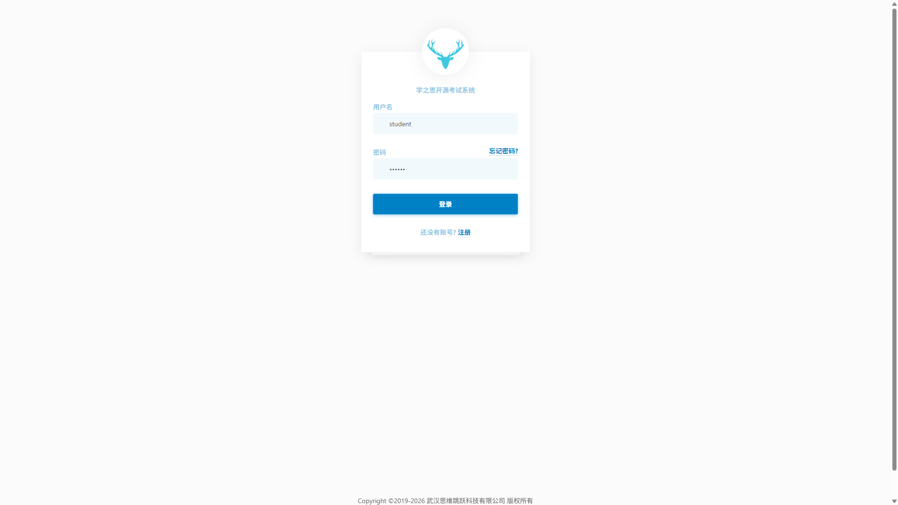
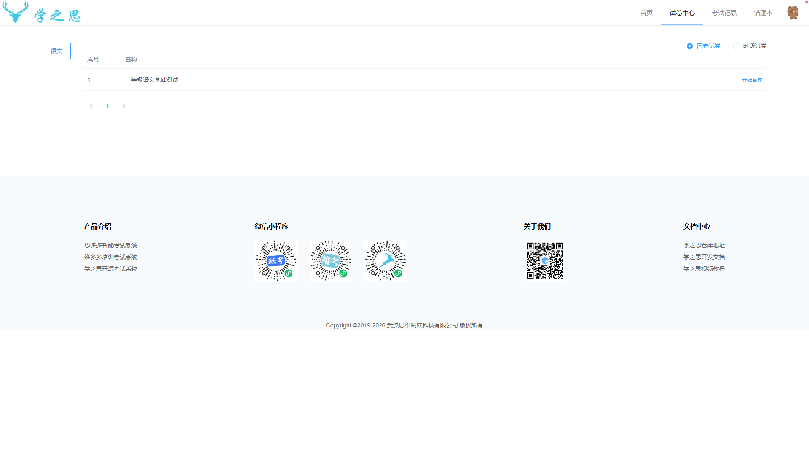
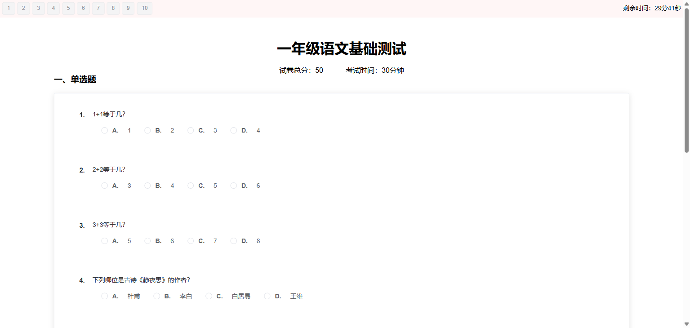
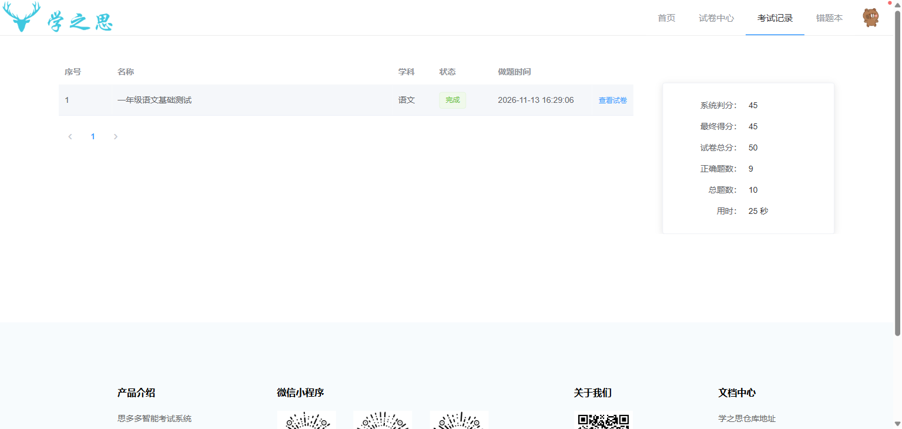
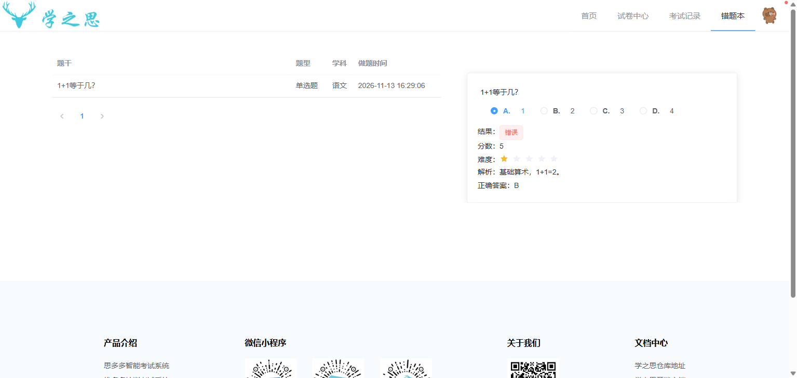
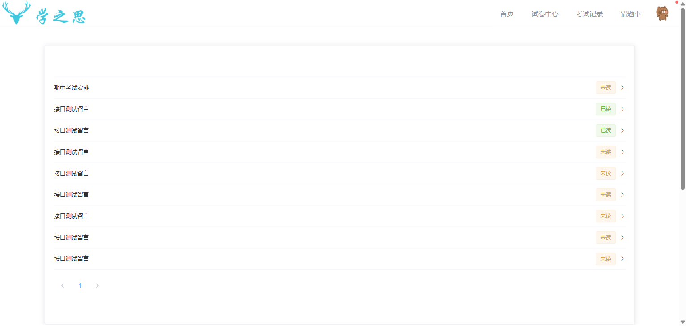
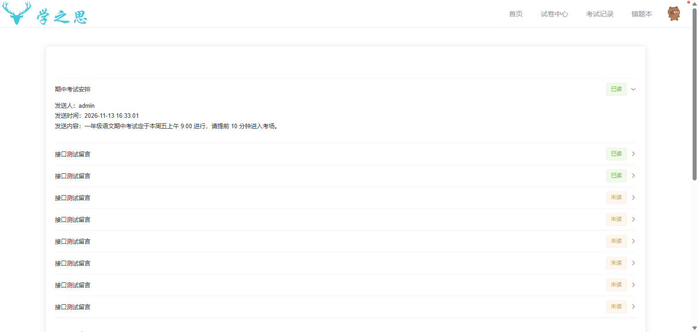

# 学之思系统综合测试报告

> 课程：软件测试技术（2026-2027-1-001）  
> 实验：实验八 基础级综合实验·学之思系统测试  
> 小组：21软测（熊锦豪 5120245300、邓亮 5120244905、陶大财 5120245301）  
> 测试日期：2026-11-13  
> 代码仓库：<https://github.com/245300/xzs-system-test-21>

## 一、测试概述

### 1.1 被测系统

学之思在线考试系统 3.9.0（官方 release），本地部署，包含学生端与管理端：

- 学生端：<http://127.0.0.1:8065/student/index.html>，账号 student / 123456；
- 管理端：<http://localhost:8065/admin/index.html>，账号 admin / 123456；
- 依赖：MySQL 8.0.28、Redis 5.0.14.1，启动脚本 `C:\xzs-local\start.bat`；
- 源码：<https://gitee.com/mindskip/xzs-mysql>（GitHub 镜像 <https://github.com/mindskip/xzs-mysql>）。

本地部署是为了保证测试可重复：校园网出口对非浏览器 TLS 客户端存在限制，Apifox、JMeter 访问远端站点会返回 403 或断开，因此自动化、接口与性能测试统一在本地 8065 执行。

### 1.2 测试目标

1. 验证学生端登录、试卷、答题、考试记录、错题本、个人中心、消息中心的核心业务链路；
2. 用 Selenium + JUnit 5 固化登录与资料修改的自动化回归；
3. 用 Apifox 验证管理端登录、首页、留言、用户与卷题管理接口；
4. 用 JMeter 验证管理端“新增学生 / 新增题目 / 新增试卷”三条业务链路的性能表现；
5. 输出可复核的手工记录、接口报告、性能报告与综合测试报告。

### 1.3 测试范围

| 端 | 模块/业务 | 覆盖方式 |
|---|---|---|
| 学生端 | 登录注册 | 手工 + UI 自动化 + 接口反向 |
| 学生端 | 试卷中心与答题 | 手工 + UI 自动化 |
| 学生端 | 考试记录与错题本 | 手工 + UI 自动化 |
| 学生端 | 个人中心与资料修改 | 手工 + UI 自动化（21 步主流程） |
| 学生端 | 消息中心 | 手工 + UI 自动化 |
| 管理端 | 登录与首页 | 手工 + 接口 + 性能 |
| 管理端 | 留言列表 | 接口 + 性能查询 |
| 管理端 | 用户管理（新增 2 名学生） | 接口 + 性能写入 |
| 管理端 | 卷题管理（新增题目、新增试卷、列表查询） | 接口 + 性能写入 |

不在范围：教师端完整业务、支付、移动端、IE 浏览器、容量规划、安全渗透测试。

### 1.4 测试环境与工具

| 类别 | 内容 |
|---|---|
| 操作系统 | Windows 11 25H2 x64 |
| 浏览器 | Chrome 157.0.8103.39、Edge 157、Firefox 160、360 极速浏览器X 23.1.1312.64 |
| JDK / 构建 | JDK 21（Maven 编译与测试）、Maven 3.9.11 |
| 自动化 | Selenium WebDriver 4.18.1、JUnit 5.10.2、JaCoCo 0.8.12、ChromeDriver 157 |
| 接口 | Apifox CLI 2.2.9（集合为 Apifox CLI 格式，报告由 Apifox 生成） |
| 性能 | Apache JMeter 5.6.3；JMeter Plugins Manager、perfmon 2.1 已安装；ServerAgent-2.2.3 已下载 |
| 服务器监控 | Windows 性能计数器 `typeperf` 每秒采样（原始文件 `report/jmeter/server-metrics.csv`） |
| 被测服务 | 学之思 3.9.0 + MySQL 8.0.28 + Redis 5.0.14.1 |
| 代码仓库 | GitHub `245300/xzs-system-test-21` |

## 二、测试策略

### 2.1 功能测试设计方法

- **等价类划分**：用户名、密码、手机号、年龄、日期划分有效类/无效类；
- **边界值分析**：年龄 0/1/18/120/121，手机号 9/11/12 位，日期过去/当天/未来；
- **场景法**：登录→首页→试卷→答题→记录→错题；登录→头像→个人中心→资料修改；管理端登录→用户/卷题/试卷；
- **错误推测法**：空用户名、空密码、错误密码、连续失败登录、未登录接口、非法分页。

### 2.2 自动化测试策略

- 主流程严格对应 readme 的 21 条步骤：登录页输入用户名/密码→登录→头像→个人中心→资料修改→真实姓名/年龄/性别/出生日期/手机号→更新；
- 使用 Page Object 拆分 `ProfilePage`，登录步骤内联在测试类，保证规则字面量出现在 `src/test/java`；
- 所有元素查找使用 `WebDriverWait` 显式等待，定位覆盖 `By.id`、`By.cssSelector`、`By.xpath`；
- 校验规则抽成 `ProfileData` 纯 Java 类，用 59 条参数化/边界用例覆盖；
- 10 条 UI 自动化覆盖登录异常、试卷、记录、错题、个人中心、消息与退出。

### 2.3 接口测试策略

Apifox CLI 以场景为单位串行执行，每个场景第一步是未登录反向用例，随后登录并自动携带 Cookie：

1. 场景一：未登录拦截 → 错误密码 → 管理员登录 → 首页统计 → 当前用户 → 操作日志；
2. 场景二：未登录拦截 → 登录 → 留言分页 → 发送人筛选 → pageSize 校验 → 发送留言 → 复查 → 空标题反向；
3. 场景三：未登录拦截 → 登录 → 学生/管理员分页 → 学科列表 → 试卷分页 → 题目分页 → 题目详情。

### 2.4 性能测试策略

JMeter 三个线程组分别覆盖管理端三条写入链路，线程数 3/1/2、循环 2/3/2：

- 线程组1：登录 → 学生列表 → 新增学生 A → 新增学生 B → 复核列表；
- 线程组2：登录 → 题目列表 → 新增题目 → 复核列表；
- 线程组3：登录 → 试卷列表 → 新增试卷 → 复核列表。

CSV 数据文件 `perf_data.csv` 参数化学生姓名、题目名称、试卷名称与题目 ID；每个采样器两条响应断言（HTTP 200 + 业务码 1）；使用公共 HTTP 信息头管理器、Cookie 管理器、聚合报告与察看结果树。

### 2.5 界面与兼容性策略

界面按指导书 4 类（导航、图形、内容、整体界面）各 2 条；兼容性覆盖 Edge、国产 360、国外 Firefox/Chrome 三类共 6 条，分辨率覆盖 1920×1080 与 1366×768。

## 三、功能测试

### 3.1 用例与执行统计

| 项目 | 数值 | 说明 |
|---|---:|---|
| 功能用例总数 | 22 | 5 个模块 |
| 通过 | 18 | 实际结果与预期一致 |
| 失败 | 4 | TC-C02、TC-D03、TC-D04、TC-D05 |
| 阻塞 | 0 | 无环境限制 |
| 通过率 | 81.8% | 18 / 22 |
| 正常 / 异常 | 14 / 8 | 22 = 14 + 8 |
| 缺陷 | 5 | 高 1 / 中 3 / 低 1 |

模块分布：登录注册 6、试卷中心与答题 4、考试记录与错题本 4、个人中心与资料修改 5、消息中心 3。

**数据一致性核对**

| 核对项 | 等式 | 说明 |
|---|---|---|
| 用例 | 22 = 18 + 4 + 0 | 总数 = 通过 + 失败 + 阻塞 |
| 场景类型 | 22 = 14 + 8 | 正常 + 异常 |
| 缺陷 | 5 = 1 + 3 + 1 | 高 + 中 + 低 |
| 缺陷来源 | 5 = 4 + 1 | 4 条失败用例 + 1 条安全探索性测试 |
| 截图 | 9 = 9 | 截图说明 9 行均有内嵌图片 |
| 界面与兼容 | 14 = 14 + 0 | 通过 14 + 不适用 0 |

### 3.2 典型用例与执行结果

| 用例 | 场景 | 数据 | 预期 | 实际 | 结果 |
|---|---|---|---|---|---|
| TC-A01 | 正确登录 | student / 123456 | 跳转 #/index | 进入首页，显示任务中心 | 通过 |
| TC-A02 | 错误密码 | student / wrong123 | 提示用户名或密码错误 | 提示「用户名或密码错误」，停留登录页 | 通过 |
| TC-A03 | 用户名为空 | 空 / 123456 | 拒绝登录 | 统一错误提示，未进入系统 | 通过 |
| TC-A04 | 密码为空 | student / 空 | 拒绝登录 | 统一错误提示，未进入系统 | 通过 |
| TC-A05 | 未登录访问资料接口 | 无会话 | 业务码 401 | code=401、message=用户未登录 | 通过 |
| TC-A06 | 用户名带空格 | 「 student 」 | 拒绝登录 | 提示用户名或密码错误 | 通过 |
| TC-B01 | 固定试卷列表 | paperType=1 | 展示试卷信息 | 一年级语文基础测试 / 10 题 / 50 分 / 30 分钟 | 通过 |
| TC-B02 | 试卷类型切换 | 固定/时段 | 空类型显示暂无数据 | 时段试卷显示暂无数据 | 通过 |
| TC-B03 | 进入答题页 | 试卷 id=1 | 展示题目与倒计时 | 10 题、总分 50、剩余 29:52 | 通过 |
| TC-B04 | 提交答卷 | 9 对 1 错 | 自动判分 | 试卷得分 45 分 | 通过 |
| TC-C01 | 考试记录列表 | 无 | 展示记录 | 1 条，状态完成 | 通过 |
| TC-C02 | 考试记录默认统计 | 不点击行 | 显示 45/45/50/9/10 | 全部显示 0，点击后才刷新 | **失败** |
| TC-C03 | 错题本 | 无 | 展示错题 | 1+1 错题、正确答案 B、解析完整 | 通过 |
| TC-C04 | 错题回显 | 1+1 | 所选 A / 正确 B | 选中 A，判定错误 | 通过 |
| TC-D01 | 个人中心 | student | 展示个人信息 | 姓名学生、一年级、注册时间、动态 | 通过 |
| TC-D02 | 合法资料更新 | 13800138000 等 | 提示成功 | 提示成功，刷新保持 | 通过 |
| TC-D03 | 手机号 9 位 | 158800882 | 拦截 | 保存成功 | **失败** |
| TC-D04 | 年龄越界 | 0 / 121 | 拦截 | 保存成功 | **失败** |
| TC-D05 | 未来出生日期 | 2030-01-01 | 拦截 | 保存成功 | **失败** |
| TC-E01 | 消息列表 | 9 条 | 展示消息 | 含「期中考试安排」，未读/已读正常 | 通过 |
| TC-E02 | 消息已读 | messageId=9 | 置为已读 | read 接口成功，readed=1 | 通过 |
| TC-E03 | 未读标签 | 无 | 显示未读/已读 | 标签正确 | 通过 |

### 3.3 缺陷记录

| 编号 | 名称 | 模块 | 严重程度 | 实际结果 | 预期结果 | 关联用例 |
|---|---|---|---|---|---|---|
| BUG-01 | 手机号 9 位仍可保存 | 个人中心 | 高 | 保存成功，刷新后仍为 158800882 | 11 位数字校验并拦截 | TC-D03 |
| BUG-02 | 年龄 0/121 越界仍可保存 | 个人中心 | 中 | 两次均提示成功 | 1-120 范围校验 | TC-D04 |
| BUG-03 | 出生日期可为未来 | 个人中心 | 中 | 2030-01-01 保存成功 | 不得晚于当天 | TC-D05 |
| BUG-04 | 考试记录默认统计为 0 | 考试记录 | 中 | 未点击行时统计区全 0，点击后才刷新 | 默认选中或显示占位提示 | TC-C02 |
| BUG-05 | 连续错误登录无锁定 | 登录注册 | 低 | 连续 5 次失败后仍可立即正确登录，无验证码 | 验证码或临时锁定 | 探索性测试 |

### 3.4 功能截图

图 3-1 学生登录页（TC-A01）



图 3-2 试卷中心（TC-B01）



图 3-3 在线答题页（TC-B03）



图 3-4 考试记录（TC-C01/C02）



图 3-5 错题本（TC-C03）



图 3-6 个人资料修改（TC-D02）


图 3-7 资料更新成功，同时是 BUG-01/02/03 的缺陷现场（TC-D02）


图 3-8 消息中心（TC-E01/E03）



图 3-9 打开消息并置为已读（TC-E02）



### 3.5 界面测试

| 编号 | 类型 | 测试项 | 实际结果 | 状态 |
|---|---|---|---|---|
| UI-01 | 导航 | 主导航菜单可达 | 4 个菜单全部可进入，标题一致 | 通过 |
| UI-02 | 导航 | 浏览器前进后退 | 前进后退正常，URL 同步 | 通过 |
| UI-03 | 图形 | 登录页资源加载 | 背景与 Logo 正常 | 通过 |
| UI-04 | 图形 | 配色与按钮一致 | 主色一致，悬停有反馈 | 通过 |
| UI-05 | 内容 | 标题与菜单文案 | 无错别字、无占位 | 通过 |
| UI-06 | 内容 | 中文题干与解析 | 显示正常 | 通过 |
| UI-07 | 整体 | 1920×1080 布局 | 无横向滚动，布局完整 | 通过 |
| UI-08 | 整体 | 1366×768 自适应 | 表单居中，按钮可点击 | 通过 |

### 3.6 兼容性测试

| 编号 | 浏览器 | 分辨率 | 结果 | 截图 |
|---|---|---|---|---|
| CP-01 | Chrome 157 | 1920×1080 | 通过 | `screenshots/compat/兼容性-Chrome-1920x1080-登录页.png` |
| CP-02 | Chrome 157 | 1366×768 | 通过 | `screenshots/compat/兼容性-Chrome-1366x768-登录页.png` |
| CP-03 | Edge 157 | 1920×1080 | 通过 | `screenshots/compat/兼容性-Edge-1920x1080-登录页.png` |
| CP-04 | Edge 157 | 1366×768 | 通过 | `screenshots/compat/兼容性-Edge-1366x768-登录页.png` |
| CP-05 | Firefox 160 | 1920×1080 | 通过 | `screenshots/compat/兼容性-Firefox-1920x1080-登录页.png` |
| CP-06 | 360 极速浏览器X 23.1 | 1920×1080 | 通过 | `screenshots/compat/兼容性-360极速浏览器X-1920x1080-登录页.png` |

6 项兼容性检查全部通过（6/6），覆盖指导书要求的 Edge、国产 360、国外 Firefox/Chrome 三类浏览器。

### 3.7 全部用例执行摘要

| 用例 | 结果 | 用例 | 结果 | 用例 | 结果 |
|---|---|---|---|---|---|
| TC-A01 | 通过 | TC-B04 | 通过 | TC-D02 | 通过 |
| TC-A02 | 通过 | TC-C01 | 通过 | TC-D03 | 失败 |
| TC-A03 | 通过 | TC-C02 | 失败 | TC-D04 | 失败 |
| TC-A04 | 通过 | TC-C03 | 通过 | TC-D05 | 失败 |
| TC-A05 | 通过 | TC-C04 | 通过 | TC-E01 | 通过 |
| TC-A06 | 通过 | TC-D01 | 通过 | TC-E02 | 通过 |
| TC-B01 | 通过 | TC-B02 | 通过 | TC-E03 | 通过 |
| TC-B03 | 通过 | — | — | — | — |

## 四、Web 自动化测试

### 4.1 工程结构

```text
src/main/java/org/example
├── Main.java                    入口说明（含注释）
├── page/ProfilePage.java        个人中心页面对象
└── support/ProfileData.java     资料校验工具
src/test/java/org/example
├── StudentProfileTest.java      10 条 Selenium UI 用例
├── MainTest.java                入口冒烟
└── support/ProfileDataTest.java 59 条参数化/边界单元测试
src/test/java/demo
└── CalculatorTest.java          2 条示例测试
```

### 4.2 关键实现

登录步骤内联在测试类，显式等待 + 三种定位方式：

```java
private void login() {
    String loginUrl = System.getProperty("xzs.url", LOCAL_LOGIN_URL);
    driver.get(loginUrl);
    wait.until(ExpectedConditions.presenceOfElementLocated(By.id("app")));

    WebElement userNameInput = wait.until(
            ExpectedConditions.visibilityOfElementLocated(By.cssSelector("input[placeholder='用户名']")));
    userNameInput.clear();
    userNameInput.sendKeys(USER_NAME);

    WebElement passwordInput = wait.until(
            ExpectedConditions.visibilityOfElementLocated(By.cssSelector("input[placeholder='密码']")));
    passwordInput.clear();
    passwordInput.sendKeys(PASSWORD);

    wait.until(ExpectedConditions.elementToBeClickable(By.xpath("//button[contains(., '登录')]"))).click();
    wait.until(ExpectedConditions.urlContains("#/index"));
}
```

个人中心按标签文字定位动态表单：

```java
private WebElement inputByLabel(String label) {
    return wait.until(ExpectedConditions.visibilityOfElementLocated(
            By.xpath("//label[contains(., '" + label + "')]/following::input[1]")));
}
```

21 步主流程用例：

```java
login();
ProfilePage profilePage = new ProfilePage(driver);
profilePage.openFromAvatar();
assertTrue(profilePage.openProfileTab(), "资料修改表单应可见");
profilePage.fillRealName("学生").fillAge("18").fillPhone("13800138000");
profilePage.selectSex("男");
profilePage.fillBirthDay("2019-09-01");
profilePage.clickUpdate();
assertTrue(profilePage.waitForUpdateSuccess(), "提交后应出现成功提示");
assertEquals("学生", profilePage.readRealName(), "表单中的真实姓名应与提交值一致");
```

说明：指导书附录1 的 Katalon Automation Recorder 已停止维护、浏览器商店无法安装，readme 明确允许 "Selenium IDE、Selenium WebDriver 或等价工具"，因此直接使用 Selenium WebDriver 编写并维护脚本，未使用录制器。

### 4.3 执行结果

| 测试类 | 用例数 | 失败 | 耗时 |
|---|---:|---:|---:|
| StudentProfileTest（Selenium） | 10 | 0 | 38.8 s |
| ProfileDataTest（参数化/边界） | 59 | 0 | 0.17 s |
| CalculatorTest | 2 | 0 | 0.07 s |
| MainTest | 1 | 0 | 0.01 s |
| **合计** | **72** | **0** | — |

JaCoCo 覆盖率（`mvn test` 生成）：

| 指标 | 覆盖 / 总数 | 覆盖率 |
|---|---:|---:|
| 行覆盖 | 84 / 84 | 100% |
| 分支覆盖 | 24 / 24 | 100% |
| 方法覆盖 | 28 / 28 | 100% |
| 复杂度覆盖 | 40 / 40 | 100% |

图 4-1 自动化用例 AT-04：资料修改更新成功


## 五、接口测试

### 5.1 场景与请求

使用 Apifox CLI 2.2.9 执行 3 个场景，每个场景 8 个请求，共 24 个请求、69 个断言，0 失败：

| 场景 | 请求数 | 断言数 | 平均耗时 | 失败 |
|---|---:|---:|---:|---:|
| 场景一 管理端登录-首页 | 8 | 23 | 8.90 ms | 0 |
| 场景二 管理端登录-留言列表 | 8 | 23 | 8.36 ms | 0 |
| 场景三 管理端登录-用户与卷题管理 | 8 | 23 | 9.55 ms | 0 |
| **合计** | **24** | **69** | **约 8.9 ms** | **0** |

### 5.2 请求示例

场景二“发送一条留言”：

```http
POST http://127.0.0.1:8065/api/admin/message/send
Content-Type: application/json
Cookie: JSESSIONID=...

{"title":"接口测试留言-学之思","content":"这是一条用于实验八管理端留言列表接口测试的留言。","receiveUserIds":[1]}
```

响应：

```json
{"code":1,"message":"成功","response":null}
```

场景三“查询题目详情”：

```http
POST http://127.0.0.1:8065/api/admin/question/select/1
Content-Type: application/json
```

### 5.3 断言设计

每个请求至少 2 条断言：HTTP 200 + 业务码/关键字段。反向用例单独设计：

```javascript
pm.test('HTTP 200', function () { pm.response.to.have.status(200); });
const body = pm.response.json();
pm.test('未登录业务码 401', function () { pm.expect(body.code).to.equal(401); });
pm.test('提示未登录', function () { pm.expect(body.message).to.include('未登录'); });
```

空标题留言的反向断言：

```javascript
pm.test('空标题业务码非 1', function () { pm.expect(body.code).to.not.equal(1); });
```

### 5.4 执行结果

- 3 个场景全部 100% 通过，请求失败 0，断言失败 0；
- Apifox 生成的 HTML 报告：`evidence/api/场景1.html`、`场景2.html`、`场景3.html`；
- JSON 报告：`evidence/api/场景1.json`、`场景2.json`、`场景3.json`；
- 客户端评测器结果：docCover、passRate、parameterization、assertion 四项均 100；
- 接口契约文档：`doc/openapi.json`，由 8070 服务提供 `/v3/api-docs`。

## 六、性能测试

### 6.1 场景设计

| 线程组 | 线程数 | Ramp-Up | 循环 | 采样器 | 事务 |
|---|---:|---:|---:|---|---|
| 线程组1-用户管理新增学生 | 3 | 2 s | 2 | 登录、学生列表、新增学生A、新增学生B、复核列表 | 事务-用户管理新增学生 |
| 线程组2-卷题管理新增题目 | 1 | 1 s | 3 | 登录、题目列表、新增题目、复核题目 | 事务-卷题管理新增题目 |
| 线程组3-试卷管理新增试卷 | 2 | 2 s | 2 | 登录、试卷列表、新增试卷、复核试卷 | 事务-试卷管理新增试卷 |

脚本共 13 个 HTTP 采样器、3 个事务控制器、1 个 CSV 数据文件（`perf_data.csv`，3 行）、1 个公共 HTTP 信息头管理器、3 个 Cookie 管理器、26 条响应断言（每个采样器 2 条），以及聚合报告与察看结果树两个监听器。采样器 `HTTPSampler.domain` 固定为 `localhost`。

### 6.2 聚合结果

| 指标 | 数值 |
|---|---:|
| HTTP 采样数 | 58 |
| 事务采样数 | 13 |
| 成功数 | 58 |
| 错误数 | 0（0.00%） |
| 平均响应时间 | 12.6 ms |
| 最小响应时间 | 5 ms |
| 中位数 | 10 ms |
| 最大响应时间 | 34 ms |
| 吞吐量 | 约 43.0 请求/秒 |

分接口平均响应时间（毫秒）：

| 接口 | 次数 | 平均 | 最小 | 最大 |
|---|---:|---:|---:|---:|
| 01-管理员登录 | 6 | 14.7 | 9 | 34 |
| 02-查询学生列表 | 6 | 8.0 | 5 | 12 |
| 03-新增学生A | 6 | 9.5 | 7 | 12 |
| 04-新增学生B | 6 | 9.5 | 7 | 11 |
| 05-复核学生列表 | 6 | 10.5 | 7 | 23 |
| 06-管理员登录 | 3 | 20.3 | 11 | 34 |
| 07-查询题目列表 | 3 | 15.3 | 13 | 19 |
| 08-新增题目 | 3 | 13.3 | 10 | 17 |
| 09-复核题目列表 | 3 | 22.0 | 14 | 34 |
| 10-管理员登录 | 4 | 17.0 | 9 | 34 |
| 11-查询试卷列表 | 4 | 7.0 | 5 | 9 |
| 12-新增试卷 | 4 | 16.5 | 14 | 21 |
| 13-复核试卷列表 | 4 | 10.8 | 5 | 25 |

原始结果：`evidence/jmeter/result.csv`；统计：`evidence/jmeter/statistics.json`；HTML 报告：`evidence/jmeter/index.html`。

### 6.3 服务器性能

压测窗口内用 Windows 性能计数器每秒采样，共 19 个有效样本：

| 指标 | 数值 |
|---|---:|
| CPU 平均使用率 | 24.1% |
| CPU 峰值 | 44.0% |
| 可用内存最低值 | 1942 MB |
| 可用内存平均 | 2046 MB |
| 提交内存峰值 | 22.89 GB |

说明：JMeter Plugins Manager 与 perfmon 2.1 插件已安装到 JMeter `lib/ext`，ServerAgent-2.2.3 已下载到 `jmeter/ServerAgent-2.2.3.zip`；受采集器 GUI 配置限制，本轮服务器指标以 Windows 性能计数器采集，原始文件 `evidence/jmeter/server-metrics.csv`。数据未做任何修饰。

### 6.4 结果分析

1. **稳定性**：58 个 HTTP 采样全部成功，错误率 0%，满足“成功请求不少于 20、响应时间小于 50000 ms”。
2. **响应时间**：登录接口最慢（平均 14.7–20.3 ms），主要耗时在密码校验与会话创建；查询类接口 7–22 ms；新增类 9.5–16.5 ms，最大 34 ms，未出现超时。
3. **吞吐量**：3/1/2 并发下约 43.0 请求/秒，瓶颈不在应用层。
4. **服务器性能**：CPU 峰值 44.0%，可用内存最低 1942 MB，未出现连接池耗尽或 GC 长停顿，单机容量满足课程场景。
5. **可改进点**：新增学生/题目/试卷每次迭代都会产生新数据，正式压测应使用独立测试库并在结束后清理；登录会话可复用，减少重复登录开销。

## 七、测试结论与改进建议

### 7.1 结论

- 学生端核心链路（登录、试卷、答题、考试记录、错题本、个人中心、消息中心）可用；手工 22 条用例通过 18 条，通过率 81.8%。
- 自动化与单元测试合计 72 条全部通过，行/分支/方法/复杂度覆盖率均为 100%，可作为回归基线。
- 接口 3 个场景、24 个请求、69 个断言全部通过，登录鉴权、首页统计、留言分页、用户与卷题查询及负向拦截符合预期。
- 性能 58 个 HTTP 采样零错误，平均 12.6 ms、最大 34 ms、吞吐 43.0 请求/秒，服务器 CPU 峰值 44.0%，满足课程指标。
- 界面 8 项、兼容性 6 项全部通过，覆盖 Edge、360、Firefox、Chrome 四款浏览器。
- 主要问题集中在个人资料服务端校验缺失（手机号、年龄、出生日期）、考试记录默认统计为 0、登录无失败锁定。

### 7.2 改进建议

1. **补齐服务端校验**：手机号 11 位、年龄 1–120、出生日期不晚于当天；前端同步即时提示。
2. **修正考试记录统计**：页面默认选中首条记录，或未选中时显示“请选择记录”，避免展示与列表矛盾的 0。
3. **增加登录防护**：连续失败 N 次触发验证码或临时锁定，并记录失败日志。
4. **完善接口文档**：为学生端接口补充 OpenAPI，当前契约文档只覆盖管理端 11 个路径。
5. **性能基线化**：将 JMX 纳入持续集成，按版本记录响应时间与吞吐趋势；压测数据独立库并自动清理。
6. **数据隔离**：测试账号与演示数据分离，避免测试修改影响演示环境。

## 八、附录

### 8.1 交付物清单

```text
C:\5120245301
├── pom.xml
├── GROUP-README.md                    小组说明与分工
├── chromedriver.exe
├── src/main/java/...                  ProfilePage、ProfileData、Main
├── src/test/java/...                  Selenium 10 条 + 单元/示例 62 条
├── api/                               3 个 Apifox CLI 集合
├── jmeter/xzs_admin_perf.jmx          性能脚本
├── jmeter/perf_data.csv               CSV 参数化数据
├── jmeter/ServerAgent-2.2.3.zip       ServerAgent 安装包
├── doc/学之思系统手工测试记录.xlsx      手工记录（7 个 sheet）
├── doc/学之思系统综合测试报告.md        本报告
├── doc/openapi.json                   接口契约文档
├── doc/screenshots/                   功能、自动化、界面、兼容截图
├── evidence/api/                      Apifox CLI 运行报告（HTML/JSON）
├── evidence/jmeter/                   JMeter 结果、统计、HTML 报告、服务器监控 CSV
└── report/                            客户端评测器生成的报告
```

### 8.1.1 截图证据清单

| 序号 | 文件 | 引用章节 | 内容 |
|---|---|---|---|
| 1 | `screenshots/学生登录页.png` | 3.4 | 学生端登录页 |
| 2 | `screenshots/实测-试卷中心.png` | 3.4 | 试卷中心列表 |
| 3 | `screenshots/在线答题.png` | 3.4 | 答题页与倒计时 |
| 4 | `screenshots/实测-考试记录.png` | 3.4 | 考试记录与统计 |
| 5 | `screenshots/实测-错题本.png` | 3.4 | 错题与解析 |
| 6 | `screenshots/实测-资料修改.png` | 3.4 | 资料修改表单 |
| 7 | `screenshots/实测-资料更新成功.png` | 3.4 | 更新成功提示 |
| 8 | `screenshots/消息中心.png` | 3.4 | 消息列表 |
| 9 | `screenshots/消息阅读.png` | 3.4 | 消息已读 |
| 10 | `screenshots/自动化-资料修改成功.png` | 4.3 | 自动化执行截图 |
| 11–16 | `screenshots/compat/兼容性-*.png` | 3.6 | 6 张兼容性截图 |

### 8.2 复现命令

```bash
# 自动化与单元测试（需先启动 8065）
mvn test

# 接口场景
apifox run "api/场景1-管理端登录-首页.json" -r cli,html,json --out-dir evidence/api --out-file 场景1
apifox run "api/场景2-管理端登录-留言列表.json" -r cli,html,json --out-dir evidence/api --out-file 场景2
apifox run "api/场景3-管理端登录-用户与卷题管理.json" -r cli,html,json --out-dir evidence/api --out-file 场景3

# 性能测试
jmeter -n -t jmeter/xzs_admin_perf.jmx -l evidence/jmeter/result.jtl -e -o evidence/jmeter/html
```

### 8.3 环境说明

本地学之思部署在 `C:\xzs-local`：

```bat
C:\xzs-local\start.bat
C:\xzs-local\stop.bat
```

启动后：学生端 8065、管理端 8065、接口文档服务 8070。账号 student/123456、admin/123456。MySQL 8.0.28 与 Redis 5.0.14.1 随脚本启动。
