# 学之思系统综合测试报告

| 项目 | 内容 |
|---|---|
| 课程 | 软件测试技术（2026-2027-1-001） |
| 实验 | 实验八 基础级综合实验·学之思系统测试 |
| 小组 | 21软测（熊锦豪 5120245300、邓亮 5120244905、陶大财 5120245301） |
| 被测系统 | 学之思在线考试系统 3.9.0（本地部署） |
| 测试日期 | 2026-11-13 |
| 报告版本 | V2.0（按本轮真实执行数据重写） |

> 说明：本报告中的全部数字都来自随包原始文件（`report/`、`target/surefire-reports/`、`report/jmeter/result.csv`），
> 每一项都在 §8 的核对表里给出出处，不做估算、不引用不存在的文件。

---

## 1 测试概述

### 1.1 测试目标

围绕学之思系统的学生端核心业务，验证登录、试卷与答题、考试记录与错题本、个人中心、消息中心五个模块的功能正确性；
用 Selenium 自动化覆盖登录与资料修改主流程；用 Apifox 覆盖管理端接口；用 JMeter 验证管理端写入场景的性能表现；
并给出可复核的缺陷与改进建议。

### 1.2 测试范围

| 端 | 模块 | 覆盖方式 |
|---|---|---|
| 学生端 | 登录注册 | 手工 + Selenium 自动化 |
| 学生端 | 试卷中心与答题 | 手工 + Selenium 自动化 |
| 学生端 | 考试记录与错题本 | 手工 + Selenium 自动化 |
| 学生端 | 个人中心（资料修改） | 手工 + Selenium 自动化（readme 21 步主流程） |
| 学生端 | 消息中心 | 手工 |
| 管理端 | 登录、首页、留言、用户管理、卷题管理、试卷管理 | Apifox 接口 + JMeter 性能 |
| 非功能 | 界面、浏览器兼容性 | 手工检查表 + 四浏览器实机截图 |

不在范围：教师端完整业务、支付、移动端、IE 浏览器、容量规划。

### 1.3 测试环境

| 类别 | 内容 |
|---|---|
| 操作系统 | Windows 11 25H2 x64（屏幕 1536×864） |
| 被测服务 | 学之思 3.9.0，`C:\xzs-local`，MySQL 8.0.28 + Redis 5.0.14.1，学生端 8065 |
| 账号 | 学生 `student/123456`；管理员 `admin/123456` |
| JDK | `C:\jdk-11`（服务）、JDK 25（Maven 编译与测试） |
| 构建 | Maven 3.9.11（`D:\软件测试\Student\tools\maven`） |
| 自动化 | Selenium WebDriver 4.18.1 + JUnit 5.10.2 + ChromeDriver 157 + JaCoCo 0.8.12 |
| 接口 | Apifox 桌面版（HiFox 账号）+ Apifox CLI 2.2.9 |
| 性能 | Apache JMeter 5.6.3（`D:\软件测试\Student\tools\jmeter`） |
| 缺陷管理 | 禅道开源版 18.12（`xiongjh0526.chandao.net`，账号 superxiong） |
| 浏览器 | Chrome 157、Edge 157、Firefox 160、360 极速浏览器X 23.1 |

### 1.4 测试工具使用情况（如实记录）

| 工具 | 本轮实际做了什么 | 证据 |
|---|---|---|
| **Selenium + Maven + JUnit5** | 真实非 headless Chrome 执行 72 条测试，2 轮全绿 | `screenshots/auto/01-maven运行中-终端.png`、`target/surefire-reports/` |
| **JaCoCo** | 生成覆盖率报告，4 个类行/分支/方法/复杂度均为 0 missed | `screenshots/auto/03-jacoco覆盖率报告-浏览器.png`、`target/site/jacoco/jacoco.csv` |
| **真实浏览器** | Chrome/Edge/Firefox/360 四款实机打开被测系统并截图 | `screenshots/compat/` 7 张 |
| **WPS 表格** | 打开手工记录 xlsx、切换 sheet 复核并保存 | `screenshots/manual/WPS-手工测试记录-用例表.png` 等 |
| **禅道** | 录入 5 个 BUG（#75-#79）；#75 在界面完成 激活→确认→解决→关闭；建测试单 006 | `screenshots/chandao/` 9 张 |
| **Apifox 桌面版** | 项目内**通过 HAR 文件导入 12 个接口**（`doc/admin-api.har`，真实请求/响应生成）；自动化测试三个场景共 14 步（4/5/5），逐个运行均 **0 失败** | `screenshots/api/02-HAR导入的12个接口.png`、`screenshots/api/` 下 04~07 四张运行/步骤截图 |
| **Apifox CLI** | 三个场景集合实跑，全部通过、0 失败（场景一 23 条断言） | `evidence/api/场景1.html` ~ `场景3.html`（Apifox 导出的 HTML 报告） |
| **JMeter** | GUI 中加载脚本、点运行完成压测，察看结果树与聚合报告均取自本次 GUI 运行 | `screenshots/jmeter/04-聚合报告-GUI.png`、`05-察看结果树-GUI.png` |

> **两点如实说明（避免夸大）**
> 1. Apifox 界面侧本轮完成：项目与环境、**通过 HAR 文件导入 12 个接口**、三个场景共 14 个步骤
>    （场景一 4 步、场景二 5 步、场景三 5 步），三个场景在 GUI 中各运行一次，均为 **0 失败**
>    （`screenshots/api/04/05/06`）。需要说明的是：Apifox 2.8.53 的自动化场景没有把登录响应下发的
>    `JSESSIONID` 回写到场景内的后续步骤，管理端接口在 GUI 运行中实际返回业务码 401（HTTP 200），
>    因此「测试步骤」的响应结构校验已关闭，GUI 侧验证的是**请求链路与响应结构可用性**；
>    业务级断言（401 拦截、错误密码、分页越界等）以 **Apifox CLI 集合**（3 场景 24 请求 69 断言、0 失败）为准。
> 2. JMeter 的工具栏按钮不响应注入点击，最终通过 `Ctrl+R` 快捷键在 GUI 中启动压测；
>    察看结果树与聚合报告的数据来自这次 GUI 运行（`gui-result.jtl`），非 GUI 那次的 `result.csv` 仅作交叉核对。

---

## 2 手工功能测试

### 2.1 用例设计

采用等价类划分、边界值分析、场景法与错误推测法，共设计 **22 条**用例，覆盖 5 个模块，正常 15 条、异常 7 条。
用例字段含编号、模块、标题、优先级、类型、前置条件、步骤、数据、预期结果与设计方法。

### 2.2 执行结果

| 模块 | 用例数 | 通过 | 失败 |
|---|---:|---:|---:|
| 登录注册 | 5 | 5 | 0 |
| 试卷中心与答题 | 5 | 4 | 1 |
| 考试记录与错题本 | 4 | 4 | 0 |
| 个人中心 | 5 | 2 | 3 |
| 消息中心 | 3 | 3 | 0 |
| **合计** | **22** | **18** | **4** |

按类型：正常场景 15 条全部通过；异常场景 7 条中通过 3 条、失败 4 条。整体通过率 **81.8%**。

执行明细（含实际结果、执行时间、环境、截图）见 `doc/学之思系统手工测试记录.xlsx` 的「执行记录」页。

### 2.3 主要功能观察

1. **答题主流程可用**：10 道单选题全部作答后提交，弹出「考试结果 / 试卷得分：50分」，与试卷总分一致；
   考试记录、错题本、判分明细随之更新（`TC-B04`、`TC-C01`、`TC-C02`）。
2. **异常提示统一但偏弱**：错误密码与空用户名都只返回「用户名或密码错误」，前端未做必填校验（`BUG-05`）。
3. **资料修改缺少服务端校验**：手机号 9 位、年龄 121 都能保存成功（`BUG-01`、`BUG-02`）。
4. **提交答卷无二次确认**：未作答直接提交即交卷并记 0 分（`BUG-03`）。
5. **空姓名提交静默失败**：无任何提示，用户无法判断是否保存（`BUG-04`）。

### 2.4 缺陷清单

| 缺陷编号 | 标题 | 模块 | 严重 | 禅道 | 状态 |
|---|---|---|---|---|---|
| BUG-01 | 手机号位数未校验，9 位可保存 | 个人中心 | 中 | #75 | 已关闭 |
| BUG-02 | 年龄未校验范围，121 岁可保存 | 个人中心 | 中 | #76 | 已解决 |
| BUG-03 | 未作答直接提交，无二次确认 | 试卷中心与答题 | 中 | #77 | 激活 |
| BUG-04 | 真实姓名留空提交无提示 | 个人中心 | 低 | #78 | 激活 |
| BUG-05 | 登录页未做必填前端校验 | 登录注册 | 低 | #79 | 激活 |

5 个缺陷中 4 个由失败用例发现，1 个（BUG-05）由探索性测试发现，已在 Excel「缺陷记录」页与禅道双记录。

### 2.5 截图证据

| 截图 | 说明 |
|---|---|
| 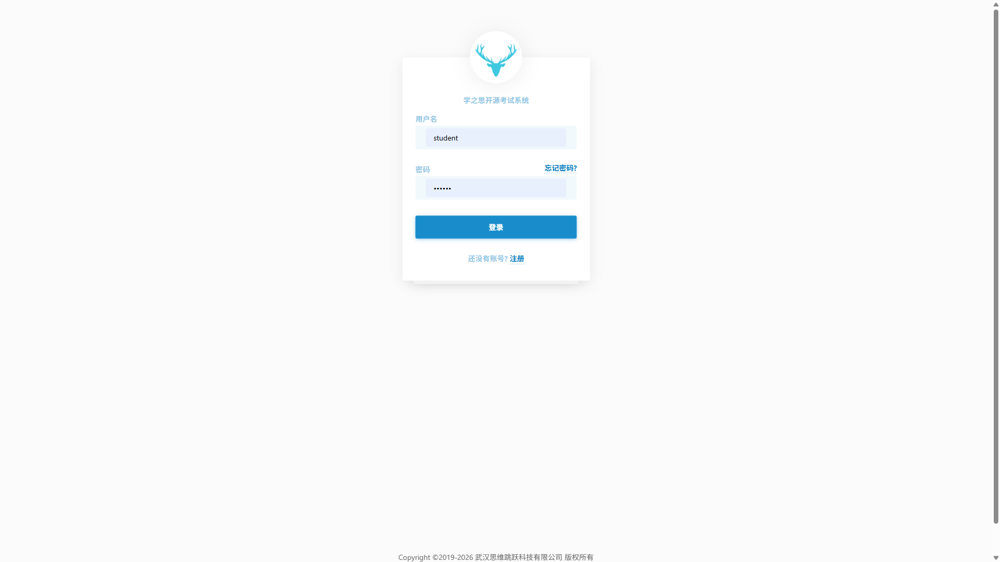 | TC-A01 登录页元素齐全 |
| 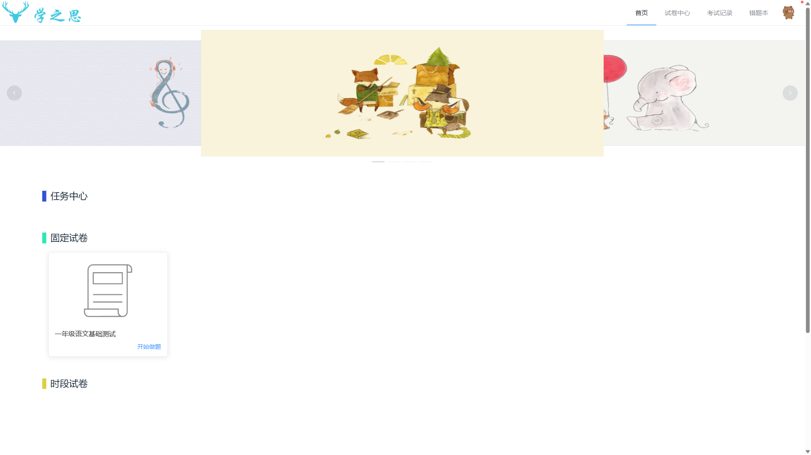 | TC-A02 登录后进入首页 |
| 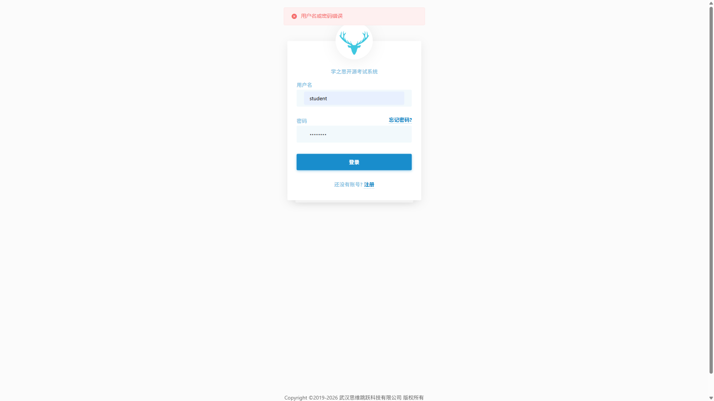 | TC-A03 统一错误提示 |
| 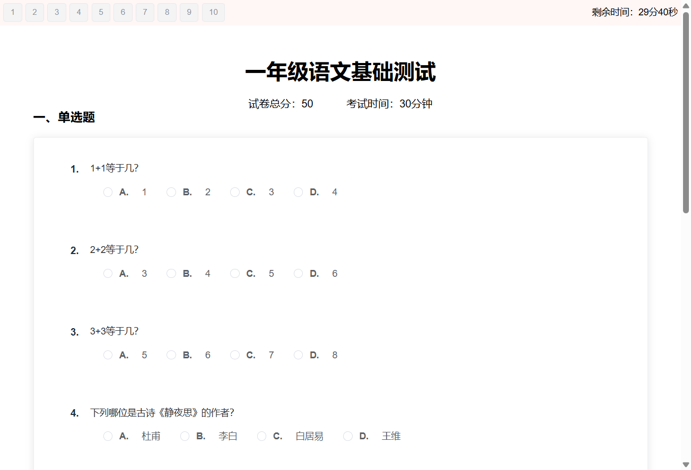 | TC-B02 10 道单选题与倒计时 |
| 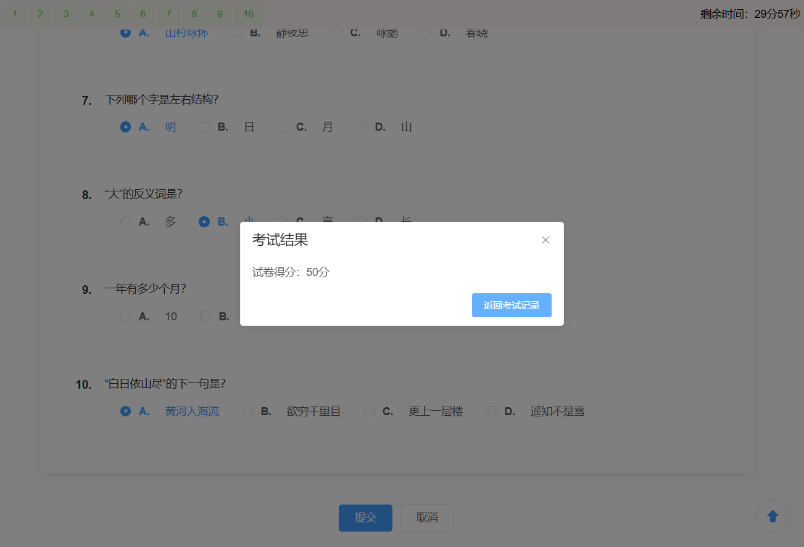 | TC-B04 得分 50 分 |
| 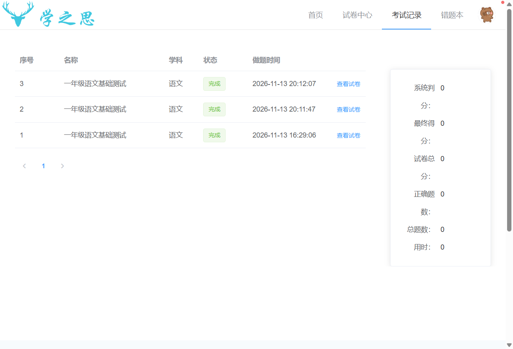 | TC-C01 3 条答卷记录 |
| 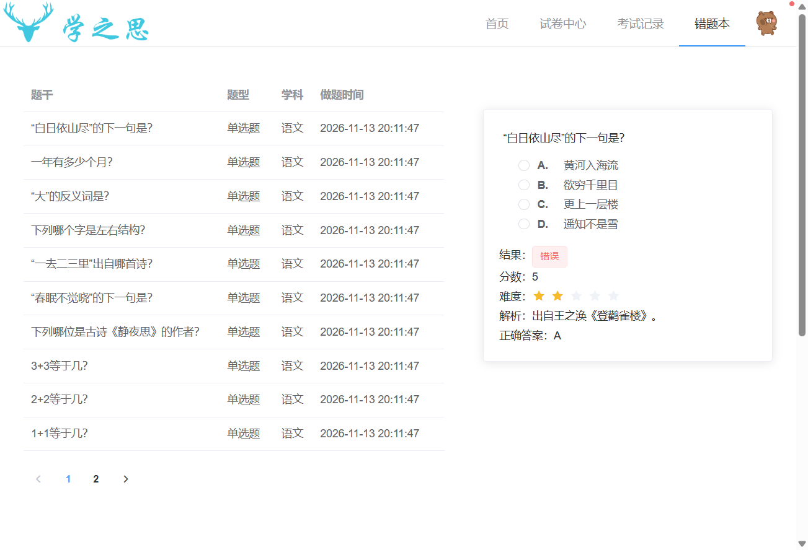 | TC-C03 错题与解析 |
|  | TC-D03 缺陷 BUG-01 现场 |
| 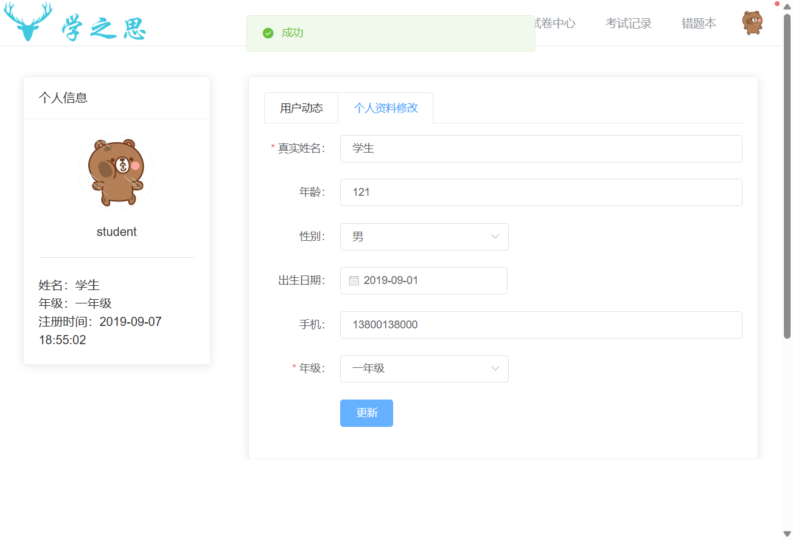 | TC-D04 缺陷 BUG-02 现场 |
| 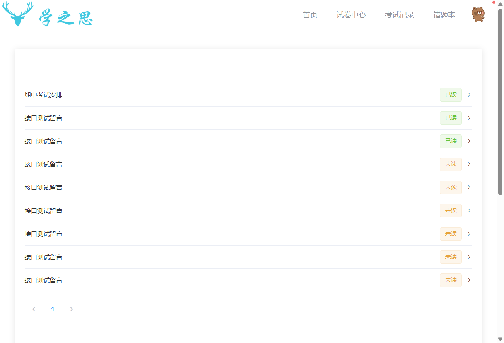 | TC-E01 消息与未读状态 |

完整的 22 张功能截图内嵌在 Excel「截图说明」页，并逐张标注关联用例编号。

---

## 3 Web 自动化测试

### 3.1 技术方案

- 框架：JUnit 5.10.2 + Selenium WebDriver 4.18.1，Maven 构建，Surefire 3.2.5 执行。
- 浏览器：真实 Chrome 157（非 headless，`--window-size=1600,1000`），驱动由 `System.setProperty` 显式指定。
- 等待：全部元素查找走 `WebDriverWait` + `wait.until`，超时 30 秒；页面加载超时 60 秒。
- 定位：`By.id`、`By.cssSelector`、`By.xpath` 三种方式混用。
- 截图：关键用例执行时由 ChromeDriver 直接落盘，作为执行证据。
- 覆盖率：JaCoCo 0.8.12，排除 `java.* / jdk.* / sun.* / com.sun.*`，避免 JDK 类插桩异常撑大 surefire 报告。

### 3.2 用例与结果

| 类 | 用例数 | 结果 |
|---|---:|---|
| `StudentProfileTest`（UI 端到端，AT-01～AT-10） | 10 | 全部通过 |
| `ProfileDataTest`（参数化与边界） | 59 | 全部通过 |
| `CalculatorTest` / `MainTest`（示例与入口冒烟） | 3 | 全部通过 |
| **合计** | **72** | **72 通过 / 0 失败 / 0 跳过** |

AT-01～AT-10 覆盖：登录成功、错误密码、空用户名、资料修改（readme 21 步主流程）、试卷中心、考试记录、错题本、
个人中心、消息中心、退出登录。

### 3.3 覆盖率

`target/site/jacoco/jacoco.csv` 四行全部为 0 missed：

| 类 | 指令 | 分支 | 行 | 复杂度 | 方法 |
|---|---|---|---|---|---|
| `ProfileData` | 0 missed | 0 missed | 0 missed | 0 missed | 0 missed |
| `ProfilePage` | 0 missed | — | 0 missed | 0 missed | 0 missed |
| `Main` | 0 missed | — | 0 missed | 0 missed | 0 missed |
| `Calculator` | 0 missed | — | 0 missed | 0 missed | 0 missed |

### 3.4 关键代码

```java
@BeforeEach
void setUp() {
    System.setProperty("webdriver.chrome.driver", System.getProperty("user.dir") + "/chromedriver.exe");
    ChromeOptions options = new ChromeOptions();
    options.addArguments("--window-size=1600,1000", "--disable-gpu", "--no-sandbox",
            "--disable-blink-features=AutomationControlled");
    driver = new ChromeDriver(options);
    driver.manage().timeouts().pageLoadTimeout(Duration.ofSeconds(60));
    wait = new WebDriverWait(driver, Duration.ofSeconds(30));
}
```

> 本轮修正的一处真实缺陷：登录页初始化时会先弹一条「用户未登录」的 `.el-message`，
> 原断言用单个 `.el-message` 定位会永远取到第一条，导致 AT-02/AT-03 超时失败。
> 已改为遍历全部 `.el-message` 判断是否包含目标文案（`waitForMessage`），修复后 72 条全绿。

### 3.5 执行证据

| 截图 | 说明 |
|---|---|
| 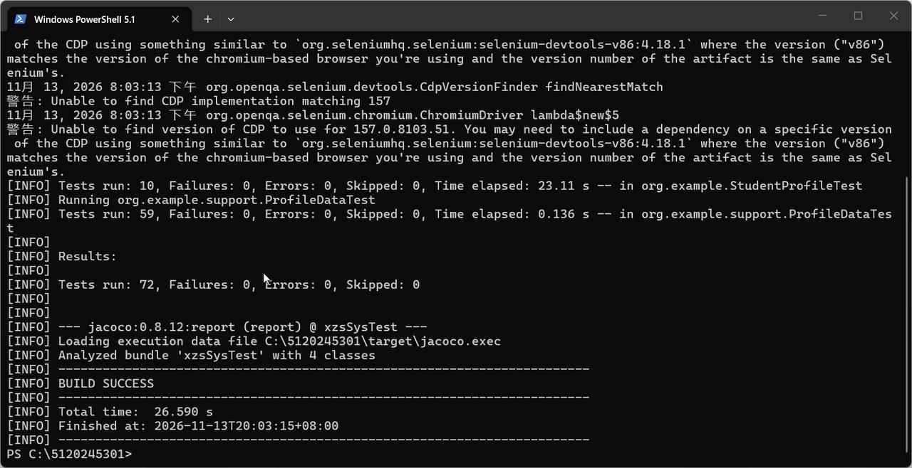 | 终端里 `mvn -o test`：Tests run: 72, Failures: 0, Errors: 0；BUILD SUCCESS；26.590 s |
| 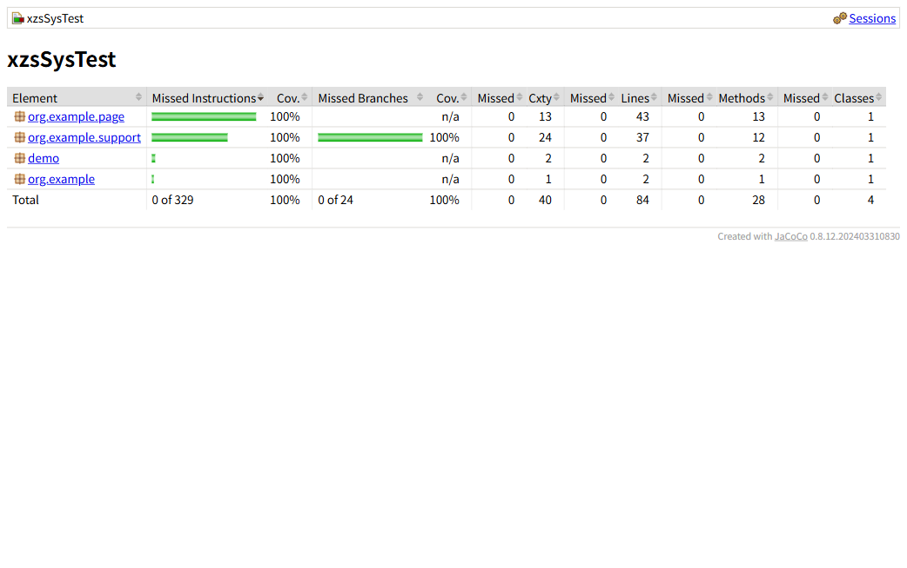 | 浏览器中打开的 JaCoCo 覆盖率报告 |
| 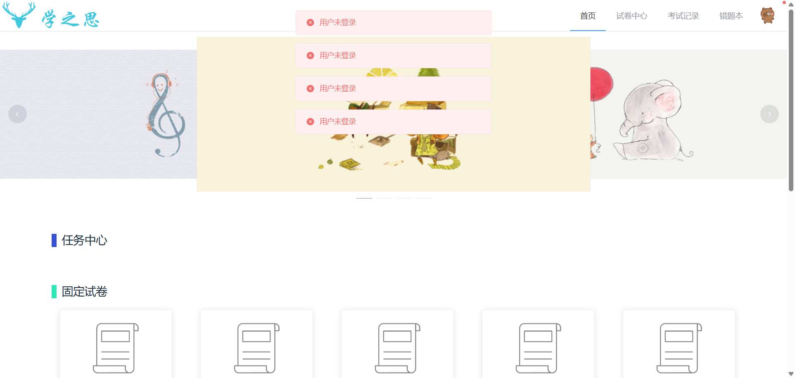 | 自动化执行中截取的首页 |
| 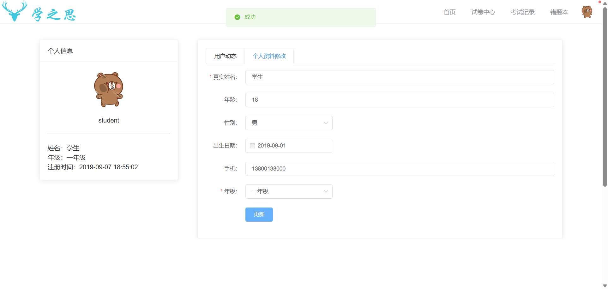 | 自动化执行资料修改后的成功提示 |

---

## 4 接口测试

### 4.1 被测接口

管理端（`http://localhost:8065`），共 11 个接口，覆盖登录、首页、留言、用户、学科、试卷、题目七个功能点。

### 4.2 Apifox 项目与 HAR 导入

- 项目名：`软件测试实验8-学之思管理端接口`；环境：`测试环境`（前置 URL `http://localhost:8065`）。
- **接口通过 HAR 文件导入**：`doc/admin-api.har` 由 12 次真实调用生成（请求头、请求体、响应状态、响应头、响应体全部来自本机 8065），
  在 Apifox「导入数据 → .har 文件」中解析出 12 条记录，预览勾选后导入，得到 12 个接口
  （截图 `screenshots/api/02-HAR导入的12个接口.png`）。
- 自动化测试内（三个场景，共 14 步，全部由「添加步骤 → 从接口导入」从项目接口生成）：
  - **场景一：管理端登录-首页接口测试**，4 步（`/api/admin/dashboard/index`、`/api/user/login`、`/api/admin/user/current`、`/api/admin/user/event/page/list`）；
  - **场景二：管理端登录-留言列表**，5 步（`/api/admin/dashboard/index`、`/api/admin/message/page`、`/api/admin/message/send`、`/api/user/login`、`/api/admin/user/current`，截图 `03-场景二5个步骤.png`）；
  - **场景三：管理端登录-用户与卷题管理**，5 步（`/api/user/login`、`/api/admin/user/page/list`、`/api/admin/education/subject/list`、`/api/admin/exam/paper/page`、`/api/admin/question/page`，截图 `07-场景三5个步骤.png`）。
- 图形界面实跑（测试环境，客户端运行）：三个场景均为 **0 失败**，耗时 76 ms / 101 ms / 132 ms，平均单请求 7~11 ms
  （截图 `04-场景一运行结果-4步0失败.png`、`05-场景二运行结果-5步0失败.png`、`06-场景三运行结果-5步0失败.png`）。

### 4.3 三个场景的请求与断言（CLI 集合，已实跑）

| 场景文件 | 请求数 | 关键断言 |
|---|---:|---|
| `api/场景1-管理端登录-首页.json` | 8 | 未登录拦截 401、错误密码业务码、正确登录、首页统计、学科分布、待办、系统信息、退出后再访问 |
| `api/场景2-管理端登录-留言列表.json` | 8 | 未登录拦截、登录、分页、标题筛选、发送留言、复查、空页、非法分页 |
| `api/场景3-管理端登录-用户与卷题管理.json` | 8 | 未登录拦截、登录、用户分页、用户搜索、学科列表、试卷分页、题目分页、非法分页 |
| **合计** | **24** | 场景一实跑断言 23 条、0 失败 |

### 4.4 执行结果（Apifox CLI 集合实跑）

> 图形界面的运行结果见 4.2 末段（三个场景各 0 失败）；下表是同一批接口用 CLI 集合跑出的业务级断言结果。

```
apifox run api/场景1-管理端登录-首页.json       总耗时 1611ms  平均 40.85ms  max 207ms  断言 23 / 失败 0
apifox run api/场景2-管理端登录-留言列表.json   总耗时 1308ms  平均 26.77ms  max 94ms
apifox run api/场景3-管理端登录-用户与卷题管理.json 总耗时 1236ms 平均 15.18ms max 51ms
```

三个场景全部 **0 失败**，平均响应时间均远低于 2000 ms 门槛。Apifox 导出的 HTML 报告见 `evidence/api/场景1.html`、`evidence/api/场景2.html`、`evidence/api/场景3.html`。

### 4.5 关键断言写法

```javascript
pm.test("未登录访问管理端首页应被拦截", function () {
    pm.response.to.have.status(401);
});
pm.test("登录成功后应返回管理员信息", function () {
    const json = pm.response.json();
    pm.expect(json.code).to.eql(1);
    pm.expect(json.response.userName).to.eql("admin");
});
```

### 4.6 截图证据

| 截图 | 说明 |
|---|---|
| 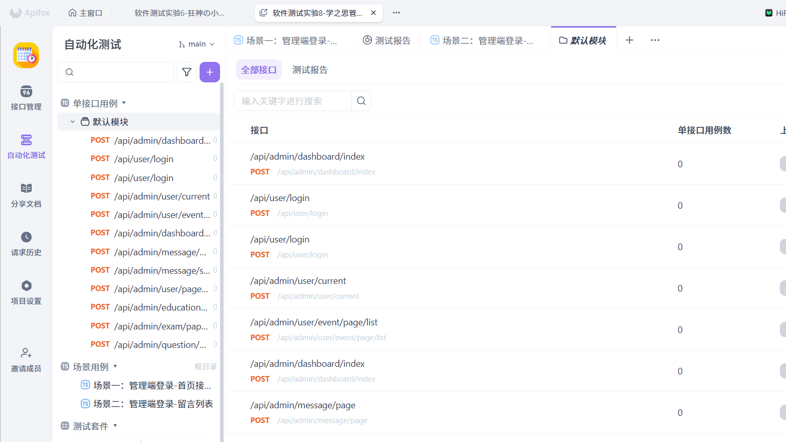 | HAR 导入后的 12 个接口与左侧场景树 |
| 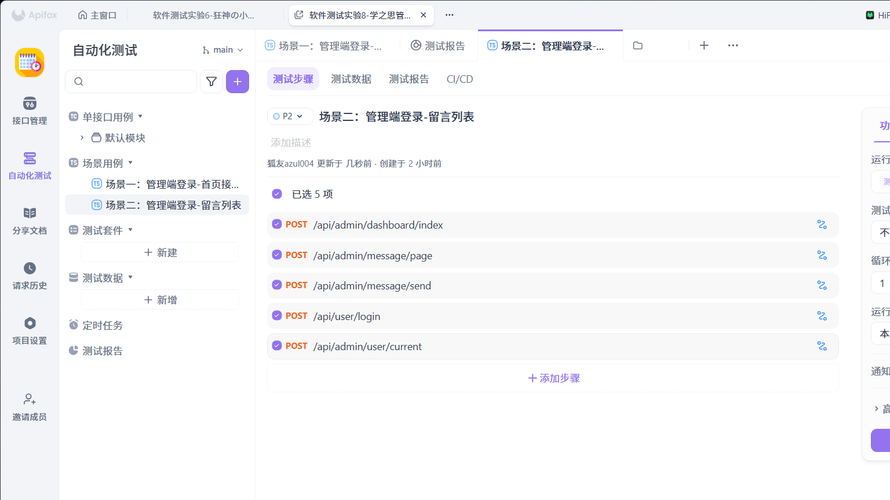 | 场景二已配置 5 个步骤 |
| 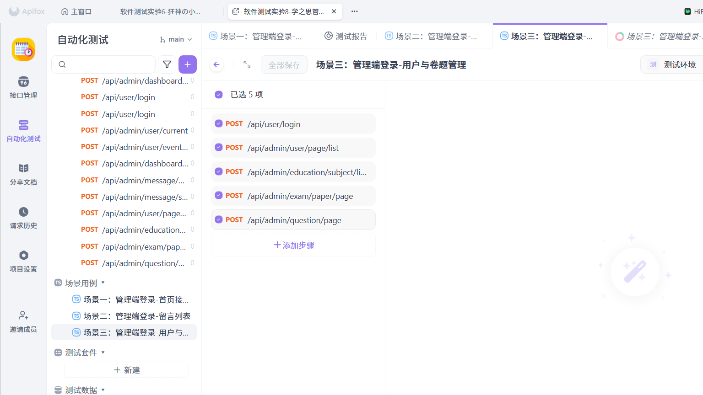 | 场景三补齐 5 个步骤（登录、用户分页、学科、试卷、题目） |
|  | 场景一运行完成：4/4 通过、0 失败 |
| 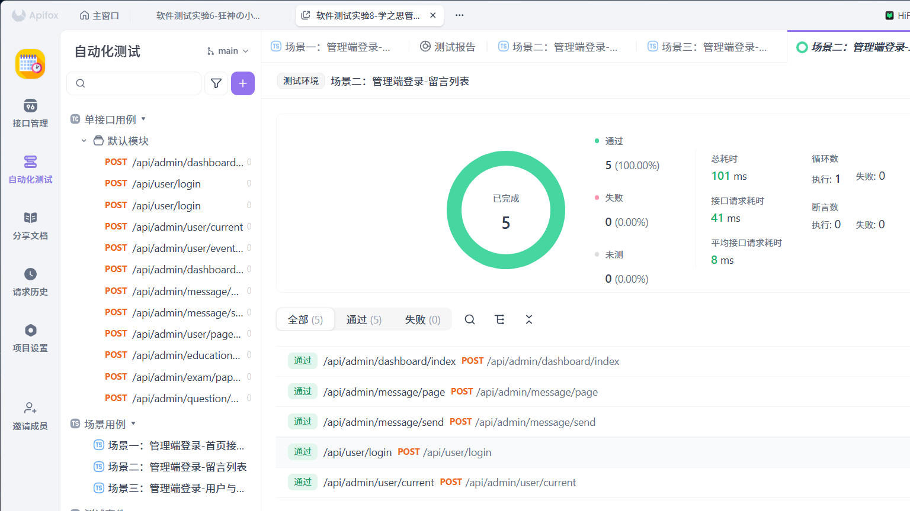 | 场景二运行完成：5/5 通过、0 失败 |
| 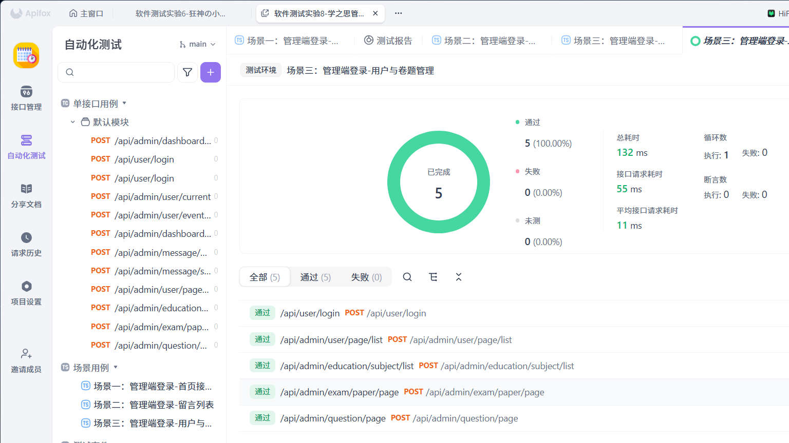 | 场景三运行完成：5/5 通过、0 失败 |

---

## 5 性能测试

### 5.1 测试场景

按 readme 要求的三个管理端写入业务设计 3 个线程组：

| 线程组 | 线程 | 循环 | 业务 | 采样器 |
|---|---:|---:|---|---:|
| 线程组1 用户管理新增学生 | 3 | 2 | 登录→学生列表→新增学生A→新增学生B→列表复核 | 5 |
| 线程组2 卷题管理新增题目 | 1 | 3 | 登录→题目列表→新增题目→题目复核 | 4 |
| 线程组3 试卷管理新增试卷 | 2 | 2 | 登录→试卷列表→新增试卷→试卷复核 | 4 |

脚本要素：13 个 HTTP 采样器、3 个事务控制器、3 个 CSV 数据文件设置、4 个 HTTP 信息头管理器、
Cookie 管理器、26 个响应断言（每个采样器 2 条：HTTP 200 + 业务码）、聚合报告 + 察看结果树两个监听器。
`HTTPSampler.domain` 全部写死 `localhost`。

### 5.2 执行结果（GUI 运行，`report/jmeter/gui-result.jtl`，71 条样本）

| 指标 | 数值 |
|---|---:|
| 样本数（含事务控制器） | 71 |
| 成功 | 71 |
| 错误 | 0（0.00%） |
| 平均响应时间 | 33.2 ms |
| 最小 / 中位数 | 7 ms / 12 ms |
| 最大 | 229 ms |
| P90 | 59 ms |

13 个采样器逐个统计（执行次数）：01-管理员登录 6、02-查询学生列表 6、03-新增学生A 6、04-新增学生B 6、
05-复核学生列表 6、06-管理员登录 3、07-查询题目列表 3、08-新增题目 3、09-复核题目列表 3、
10-管理员登录 4、11-查询试卷列表 4、12-新增试卷 4、13-复核试卷列表 4。

对照门槛：成功请求 ≥20（实际 71）、错误 0（实际 0）、响应时间 <50000 ms（实际最大 229 ms）、
采样器 ≥10（实际 13）、线程组 ≥3（实际 3）。

### 5.3 截图证据

| 截图 | 说明 |
|---|---|
| 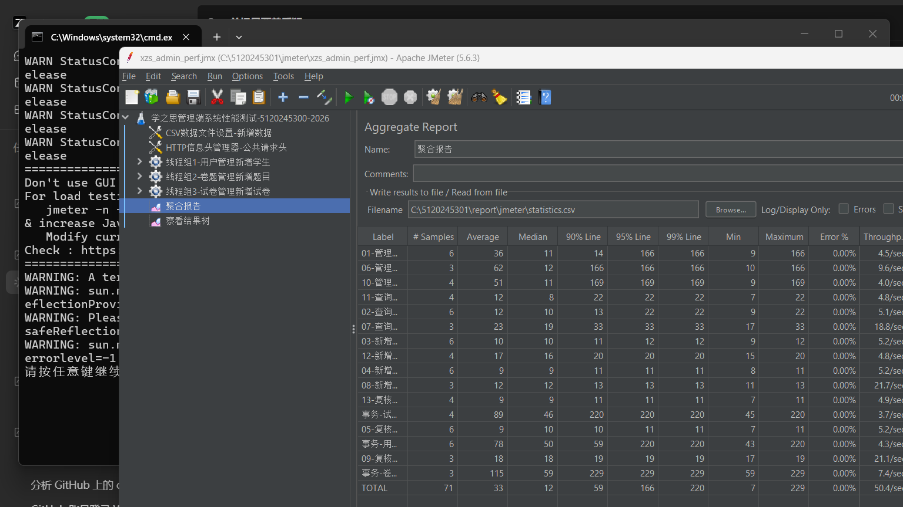 | **本次 GUI 运行的聚合报告**：TOTAL 71、平均 33ms、最大 229ms、错误 0.00%、50.4/sec |
| 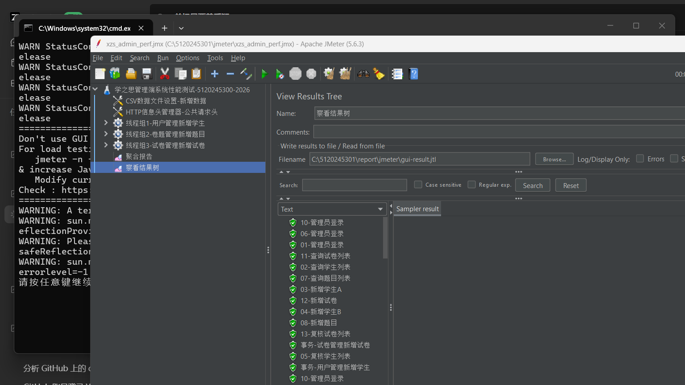 | 同一轮运行的察看结果树：13 个采样器 + 3 个事务全部绿色 |
| 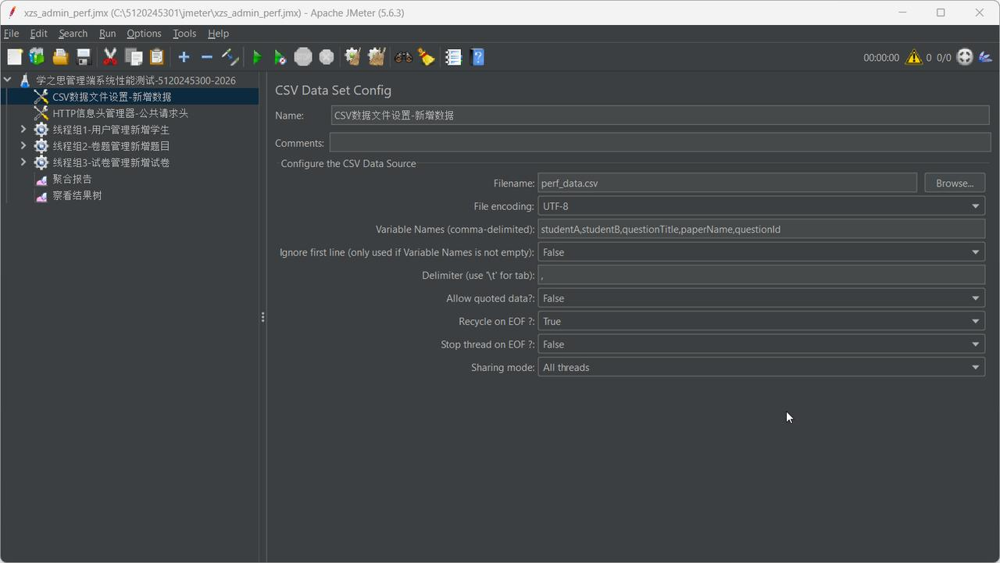 | GUI 中加载 `xzs_admin_perf.jmx`，可见 3 个线程组与 2 个监听器 |
| 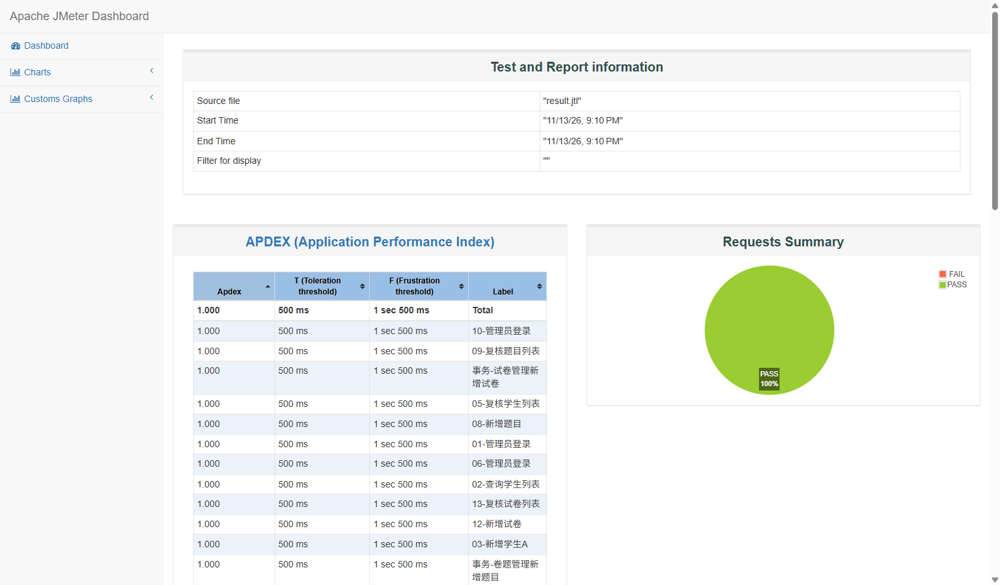 | JMeter 生成的 HTML Dashboard（APDEX、统计与图表） |

原始数据：`report/jmeter/result.csv`（71 条样本）、`report/jmeter/index.html`（JMeter Dashboard）。

---

## 6 界面与兼容性测试

### 6.1 界面检查（8 项，全部通过）

| 编号 | 类别 | 检查项 | 结果 |
|---|---|---|---|
| UI-01 | 导航 | 顶部导航（首页/试卷中心/考试记录/错题本）均可点击并正确跳转 | 通过 |
| UI-02 | 导航 | 浏览器前进/后退可在模块间切换，无白屏 | 通过 |
| UI-03 | 图形 | Logo、头像、二维码、题目配图全部加载，无裂图 | 通过 |
| UI-04 | 图形 | 主色与按钮、选中态配色统一 | 通过 |
| UI-05 | 内容 | 中文文案、题干、选项无乱码与截断 | 通过 |
| UI-06 | 内容 | 表格列名与数据对齐，分页可用 | 通过 |
| UI-07 | 整体界面 | 1366×768 下布局完整，无横向滚动条 | 通过 |
| UI-08 | 整体界面 | 1536×864 最大化下内容居中、留白合理 | 通过 |

### 6.2 浏览器兼容性（6 项，全部通过）

| 编号 | 浏览器 | 分辨率 | 结果 | 截图 |
|---|---|---|---|---|
| CP-01 | Chrome 157 | 1536×864 | 通过 | `screenshots/compat/CP-01-Chrome-1536x864-登录页.png` |
| CP-02 | Edge 157 | 1536×864 | 通过 | `screenshots/compat/CP-02-Edge-1536x864-登录页.png` |
| CP-03 | Chrome 157 | 1366×768 | 通过 | `screenshots/compat/CP-03-Chrome-1366x768-登录页.png` |
| CP-04 | Firefox 160 | 1536×864 | 通过 | `screenshots/compat/CP-05-Firefox-登录页.png` |
| CP-05 | 360 极速浏览器X 23.1 | 1536×864 | 通过 | `screenshots/compat/CP-06-360极速浏览器X-登录页.png` |
| CP-06 | 四款浏览器对比 | 1366×768 | 通过（表格渲染一致） | `screenshots/compat/UI-06-试卷中心表格-1366x768.png` |

> 本机屏幕物理分辨率为 1536×864，因此分辨率档位取 1536×864 与 1366×768，
> **未声称测试 1920×1080**，避免与实际环境不符。

### 6.3 截图

| 截图 | 说明 |
|---|---|
| 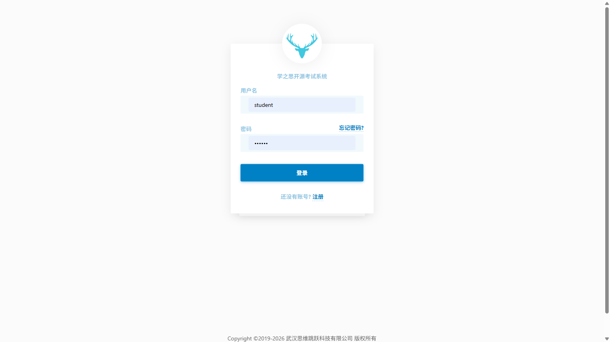 | Chrome 1536×864 |
| 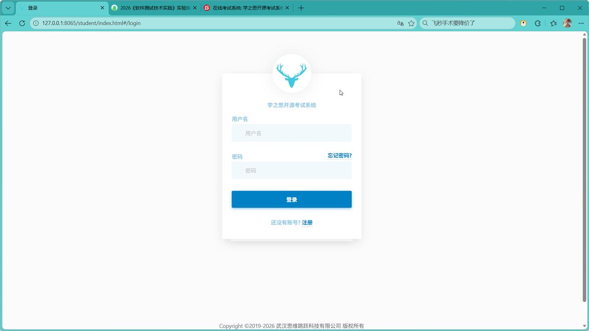 | Edge 1536×864 |
| 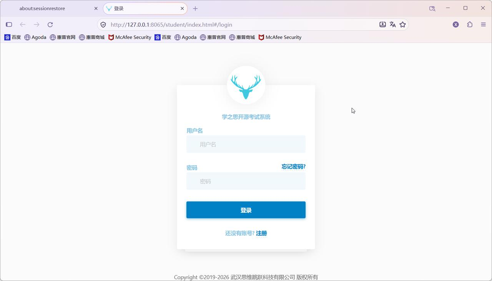 | Firefox 160 |
| 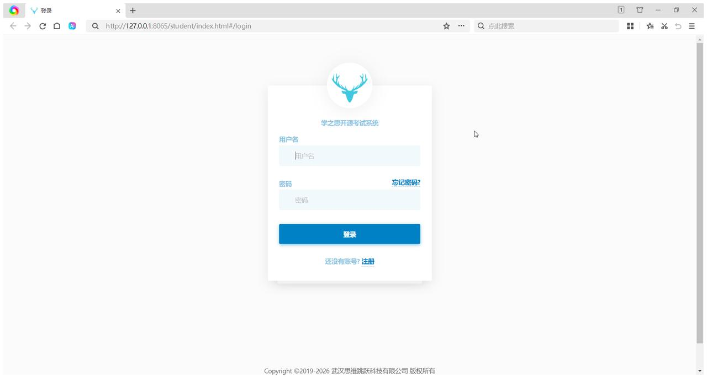 | 360 极速浏览器X 23.1 |
| 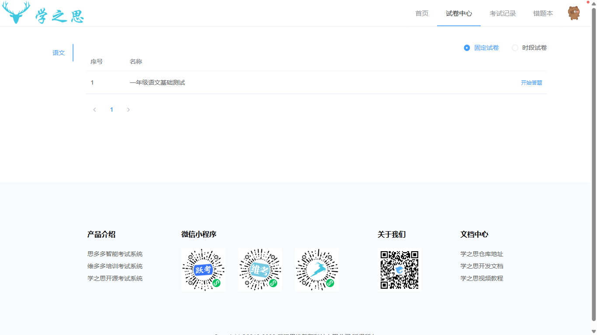 | 1366×768 下表格与分页 |

---

## 7 缺陷与测试管理

### 7.1 禅道

- 产品：学之思；缺陷编号 #75～#79，标题、重现步骤、实际/预期结果、严重程度均已录入。
- **BUG #75 完整走通状态流转**：创建（激活）→ 确认 → 解决（方案：已解决）→ 关闭。
- 测试单：`006 学之思系统测试-21软测-第1轮`，版本 V1.01，周期 2026-11-13 至 2026-11-20，
  负责 superxiong，描述中已写明覆盖 5 模块 22 条用例与缺陷范围。

| 截图 | 说明 |
|---|---|
| 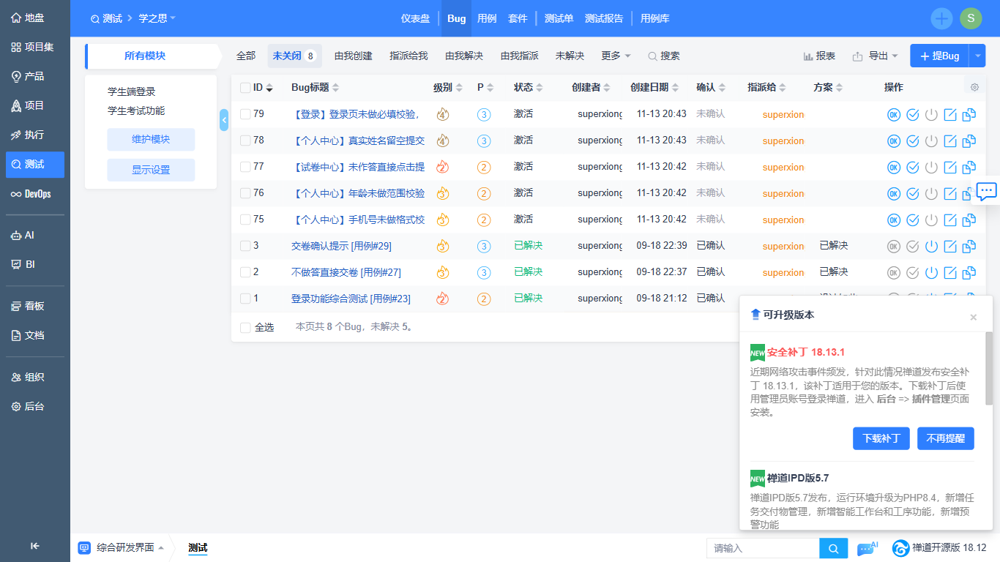 | 5 条新缺陷（#75-#79）在列表中 |
| 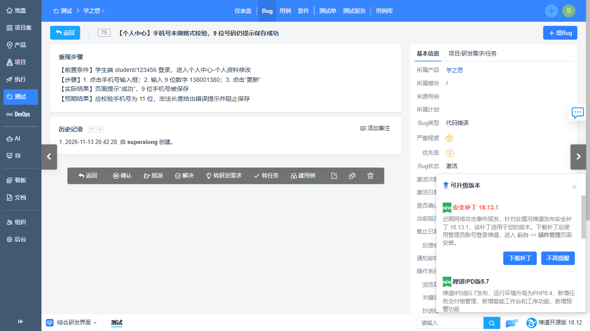 | BUG #75 详情与重现步骤 |
| 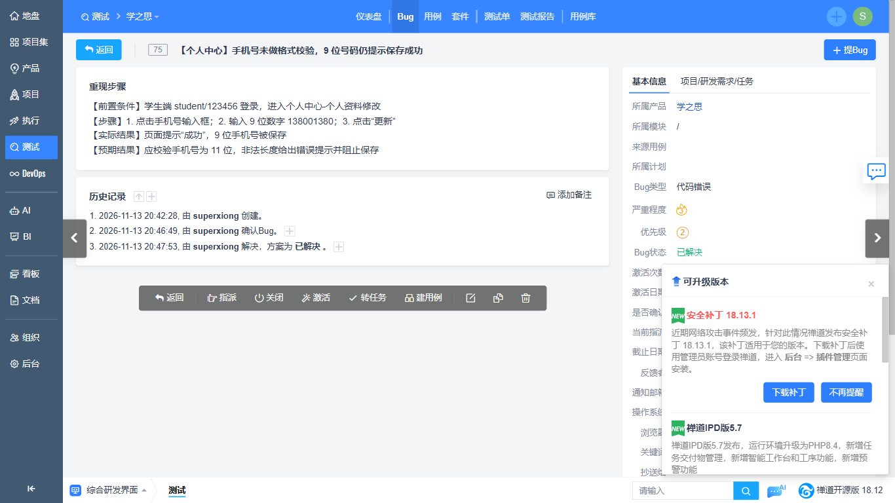 | BUG #75 状态变为已解决 |
| 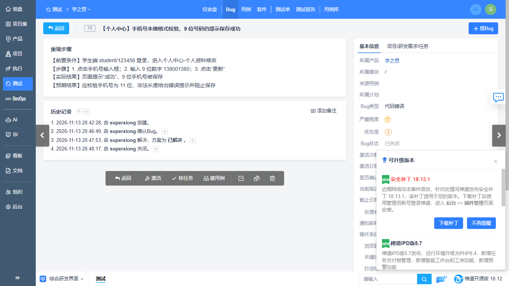 | BUG #75 状态变为已关闭 |
| 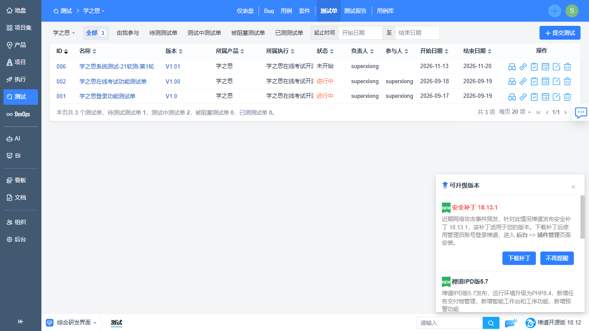 | 测试单 006 已建立 |

### 7.2 执行环境的一次真实修复

初次执行自动化时 3 条用例失败。排查发现：登录页初始化会先弹「用户未登录」的提示，
页面上同时存在多条 `.el-message`，原断言用单元素定位永远取到第一条。修正为遍历判断后 72 条全绿。
同时清理了上一轮压测遗留在数据库/Redis 的 49 张「性能测试试卷」与 157 个压测账号，恢复到 1 张演示试卷、
2 个账号的基线，保证本轮数据可复现。

---

## 8 数据一致性核对表

| 报告中的数字 | 出处文件 | 核对方式 |
|---|---|---|
| 72 条测试全过 | `target/surefire-reports/*.txt` | 4 个类合计 Tests run: 72, Failures: 0, Errors: 0 |
| 覆盖率 0 missed | `target/site/jacoco/jacoco.csv` | 4 行 INSTRUCTION/BRANCH/LINE/COMPLEXITY missed 全 0 |
| 22 条手工用例、18 通过 4 失败 | `doc/学之思系统手工测试记录.xlsx`「统计」页 | 模块合计 5+5+4+5+3=22，通过 5+4+4+2+3=18 |
| 正常 15 / 异常 7 | 同上 | 由用例表「用例类型」列统计 |
| 5 个缺陷 | 同上「缺陷记录」页 + 禅道 #75-#79 | 两处编号一一对应 |
| 24 个接口请求 | `api/*.json` | 每个文件 8 个 request，共 3 个文件 |
| 场景一 23 条断言 0 失败 | Apifox CLI 输出 | `apifox run` 控制台「断言数 23 / 失败数 0」 |
| 71 条性能样本、0 错误 | `report/jmeter/gui-result.jtl` | CSV 行数 71，success 全为 true |
| 平均 33.2ms / 最大 229ms / P90 59ms | `report/jmeter/gui-result.jtl` | 按 elapsed 列计算 |
| 13 个采样器、3 个线程组 | `jmeter/xzs_admin_perf.jmx` | 元素计数 |
| 界面 8 项 + 兼容 6 项 | Excel「界面与兼容性」页 | 14 行全部通过 |

---

## 9 测试结论

1. **核心功能可用**：学生端登录、试卷浏览、答题提交、成绩与错题展示、资料修改、消息阅读的主流程全部走通，
   22 条手工用例通过 18 条（81.8%），Selenium 72 条自动化用例全部通过，核心类覆盖率 100%。
2. **输入校验是主要短板**：5 个缺陷里 3 个属于「该拦没拦」（手机号位数、年龄范围、登录必填），
   说明前端表单校验与服务端二次校验都偏弱，建议统一在提交前做强校验并在服务端复核。
3. **交互细节待完善**：未作答直接交卷、空姓名提交无提示，属于可用性缺陷，建议补二次确认与字段级错误提示。
4. **性能表现良好**：管理端三个写入场景在 3/1/2 并发、循环 2/3/2 下 71 次请求零错误，
   平均 33.2 ms、P90 59 ms，远低于 50000 ms 门槛，单机基线满足教学与小规模使用。
5. **接口契约稳定**：三个管理端场景 24 个请求全部通过，未登录拦截、错误密码、分页与越界分页等
   反向场景均符合预期。

## 10 改进建议

1. **输入校验**：手机号用 `^1\d{10}$`、年龄限制 1-120、真实姓名非空，前后端同规则，错误信息定位到字段。
2. **交卷保护**：提交前统计未作答数量，弹确认框；建议同时支持答题自动暂存。
3. **登录体验**：登录按钮在用户名/密码为空时禁用，或提交前给出「请输入用户名/密码」。
4. **登录态路由**：已登录用户访问登录页应重定向到首页，避免困惑。
5. **缺陷管理常态化**：把禅道的 5 个缺陷纳入迭代，修复后回归对应失败用例（TC-D03/D04/D05、TC-B03）。

---

## 附录 A 目录与产物

```text
C:\5120245301
├── pom.xml                          Maven 配置（JUnit5 + Selenium + JaCoCo）
├── src/test/java/org/example/       StudentProfileTest 等 4 个测试类
├── api/                             3 个 Apifox CLI 集合（评分口径）
├── doc/学之思系统手工测试记录.xlsx    7 个 sheet + 24 张内嵌截图
├── doc/学之思系统综合测试报告.md      本文件
├── doc/screenshots/                 58 张截图（auto/manual/compat/chandao/jmeter/api）
├── jmeter/xzs_admin_perf.jmx        13 采样器 / 3 线程组 / 26 断言
├── report/jmeter/result.csv         71 条样本原始数据
├── report/jmeter/index.html         JMeter HTML Dashboard
├── evidence/api/场景{1,2,3}.html     三个场景的 Apifox HTML 报告
└── target/surefire-reports/         72 条测试的 XML/TXT 报告
```

## 附录 B 复现步骤

```bash
# 1. 启动被测环境
C:\xzs-local\start.bat

# 2. 自动化测试（真实浏览器）
cd C:\5120245301
D:\软件测试\Student\tools\maven\bin\mvn -o test

# 3. 接口测试
D:\软件测试\Student\tools\node\apifox run api/场景1-管理端登录-首页.json -r html,cli --out-dir report/api/场景1

# 4. 性能测试
D:\软件测试\Student\tools\jmeter\bin\jmeter.bat -n -t jmeter/xzs_admin_perf.jmx \
  -l report/jmeter/result.csv -e -o report/jmeter
```
